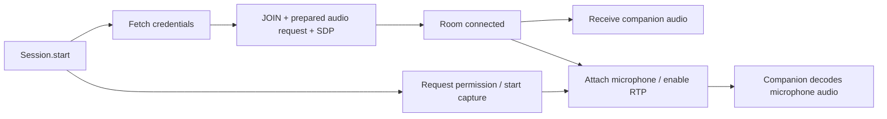

# Session startup and first decoded audio

`Session.start()` now fetches credentials and connects concurrently with microphone capture. In Single PeerConnection mode it reserves an audio transceiver and sends its publication request and SDP with JOIN. The reserved sender's RTP encoding stays inactive until capture succeeds; native audio senders can otherwise transmit the shared audio engine even without an attached track. Attaching the microphone then activates that sender without another AddTrack request or SDP exchange.

The Session public API and default dual-PC setting are unchanged. Audio publication flags and encoding are taken from the Room's existing default audio publish options. Both publication paths share the audio request builder. Encryption and dual-PC use ordinary publication after capture and connection finish, while still overlapping capture with connection. Pre-connect buffering remains controlled by `SessionOptions.preConnectAudio`. `Session.start()` completes after microphone publication; Room connection and incoming audio can become ready earlier.



Cancellation owns the connection, capture, and completion tasks. Ending a Session waits for connection teardown, without waiting for a system permission callback. A late callback cleans up its own track and cannot publish into, disconnect, or flush the buffer of a newer startup. The reserved publication CID is retained for quick reconnect; full reconnect uses the existing republish path.

## Run

Requires macOS, Xcode 26+, Node, Python 3, and `livekit-server` on PATH. Ports 17880–17883 must be free. From the repository root:

```sh
LK_SESSION_BENCHMARK_SAMPLES=10 scripts/benchmark-session-audio.sh
```

The runner starts and stops only its own SFU and signaling relay. It writes the test log, raw samples, and median/p95 summary into `Benchmarks/SessionStartup/results`. Set `ONE_WAY_MS=0` to run without added signaling delay, or pass an output directory as the first argument. The first pair per scenario is a warmup and is excluded. Baseline/prepared order alternates across the remaining pairs.

The benchmark compares the previous capture → credential fetch → connect → publish sequence against the new actual `Session.start()` implementation. It measures three timestamps from the start action:

- Room's connected event.
- First non-silent decoded microphone PCM at a remote participant.
- First non-silent decoded companion PCM at the Session.

It uses native manual rendering with a generated 400 Hz tone, real Opus encoding, a local LiveKit SFU, native WebRTC transport and decoding, and audio renderer callbacks. It asserts that outgoing audio never precedes capture readiness. Both SPC and dual-PC are measured, with immediate capture and an injected 800 ms capture delay, using default pre-connect buffering. Credential fetching has an injected 100 ms delay. A warm companion publishes before each measured start, modeling audio that is already available when the user joins.

The default relay adds 50 ms in each direction to TCP signaling. ICE/DTLS/SRTP/SCTP use direct local UDP; **this is not a 100 ms full media-network RTT simulation**. The generated source and injected capture delay do not measure physical microphone startup, permission-dialog behavior, device playback, UI rendering, production authentication, agent dispatch, or STT/LLM/TTS latency. Results establish first decoded media improvements for these controlled conditions, not a universal production latency guarantee.

## Validation

```sh
LIVEKIT_TESTING_URL=ws://localhost:7880 xcrun swift test -j 4 \
  --filter 'SessionStartupTests|PreparedAudioPublicationTests|PublishWithJoinTests|SessionOptionsTests'
```

Coverage includes capture pending during JOIN, both PC modes, pre-connect buffering on/off, reservation RTP disabled before capture, late permission completion after end/restart, capture failure, encryption fallback, quick/full reconnect, task-owner destruction, and existing publish-on-join behavior. Run the opt-in benchmark separately: it changes process-wide AudioManager configuration.

## Staging

Use the credentials from your shell; the reports contain no API credentials:

```sh
export LIVEKIT_TESTING_URL="$LIVEKIT_URL"
export LIVEKIT_TESTING_API_KEY="$LIVEKIT_API_KEY"
export LIVEKIT_TESTING_API_SECRET="$LIVEKIT_API_SECRET"
LK_SESSION_STAGING_TESTS=1 xcrun swift test -j 4 \
  --filter 'SessionStagingValidationTests|PreparedAudioPublicationTests'
LK_SESSION_BENCHMARK=1 LK_SESSION_BENCHMARK_SAMPLES=10 xcrun swift test -j 4 \
  --filter SessionPublicationBenchmarkTests > /tmp/session-staging.log 2>&1
python3 scripts/summarize-session-audio.py /tmp/session-staging.log \
  Benchmarks/SessionStartup/staging --environment staging \
  --endpoint "$LIVEKIT_TESTING_URL" --added-signaling-rtt-ms 0
```

The staging benchmark uses the real Cloud signaling and media network directly, with no latency relay. It retains the same modeled 100 ms credential fetch and 0/800 ms capture cases as the local comparison. Each sample logs actual Single-PC mode, whether the JOIN reservation was used, selected ICE-pair RTT, media protocol, and signaling ping RTT. Network probes run after the latency timestamps have been captured. The staging compatibility fixture also generates continuous audio so reconnect checks exercise a live publication.

With immediate capture, incoming audio need not improve: capture introduces little delay in either flow, and preparing an outgoing publication does not remove the incoming track's subscription negotiation. The delayed-capture case demonstrates joining and receiving audio without waiting for microphone permission or startup.

## Staging results — 2026-11-21 UTC

Source: `3af10bdf`. Direct staging endpoint, 10 measured pairs per case plus an excluded warmup pair: 80 measured starts. All media connections used UDP. Across measured samples, median signaling ping RTT was 62 ms and selected ICE-pair RTT was 64 ms. Every prepared SPC sample used the JOIN reservation; dual-PC samples used ordinary publication. Session API and PC defaults are unchanged.

All numbers below are medians from the start action, in milliseconds (previous flow → prepared flow):

| Requested mode / injected capture delay | Room connected | Peer receives microphone PCM | Session receives companion PCM |
|---|---:|---:|---:|
| Single-PC / 0 ms | 400 → 405 | 590 → 569 | 509 → 518 |
| Single-PC / 800 ms | 1,206 → 399 | 1,400 → 890 | 1,319 → 512 |
| Dual-PC / 0 ms | 412 → 440 | 624 → 633 | 530 → 529 |
| Dual-PC / 800 ms | 1,252 → 422 | 1,459 → 989 | 1,334 → 534 |

The strong result is overlapping a slow capture operation with JOIN. Immediate-capture differences are small and inconclusive: the paired bootstrap 95% interval for outgoing savings is −4 to +68 ms for SPC and −59 to +39 ms for dual-PC. This staging run does not establish a reliable first-audio gain with already-ready capture. For delayed capture, the corresponding outgoing intervals are +498 to +525 ms (SPC) and +435 to +483 ms (dual-PC). Intervals describe these ten pairs, not production guarantees.

The incoming path does not wait for outgoing publication in either flow once JOIN is under way. When capture is immediate, preparation therefore has little opportunity to accelerate companion audio. When capture is delayed, starting JOIN immediately removes that capture wait from the incoming path.

Both participants run in one test process and share a warmed native audio engine/factory. These are real decoded PCM measurements over the staging media network, with synthetic audio and modeled credential/capture delays; they exclude physical microphone startup, cold application launch, speaker playback latency, UI rendering, and real agent inference.

[Raw staging samples](staging/samples.csv), [staging median/p95, RTT observations, and paired intervals](staging/results.json), [final local comparison with 100 ms added signaling delay](local-100ms/results.json).

Validation: the local 24-test regression run passed; staging compatibility checks (both PC modes and buffering options, cancellation/restart, capture failure, encryption fallback, quick/full reconnect, inactive RTP reservation, owner destruction) and native SDP identity checks passed. Quick reconnect may fall back to full reconnect on Cloud; the test waits for asynchronous republishing before checking the retained or replaced publication CID.
